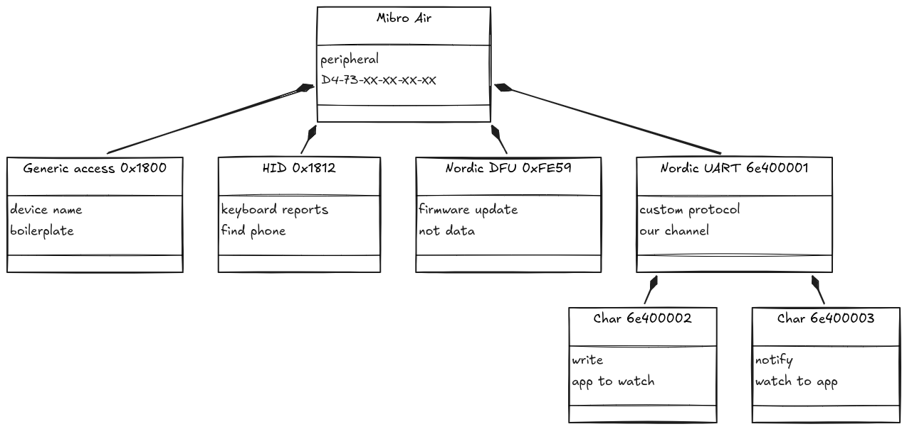
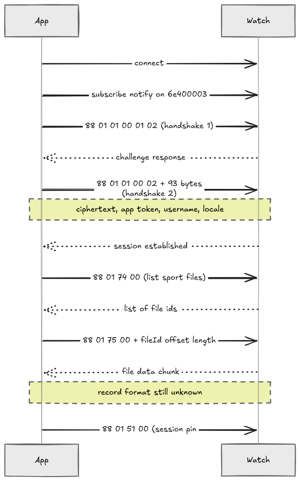
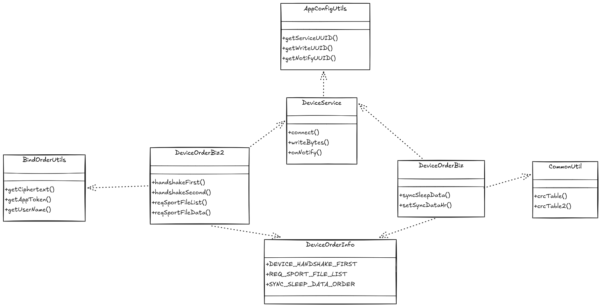

# Reverse-engineering the Mibro Air Bluetooth protocol

Reading a Mibro Air smartwatch directly over Bluetooth Low Energy — steps, calories,
hourly heart rate and sleep staging — without the vendor app, a vendor account, or
any network access.

**Headline result:** the watch speaks the older Xiaoxun `0xAB` packet family and
performs **no authentication**. Subscribe to its Nordic UART notify characteristic
and it starts talking immediately. A working Python client is in this repository.

| What | Command | Status |
|---|---|---|
| Battery level | push on connect | Verified |
| Firmware version | push on connect | Verified |
| Steps / calories / heart rate | `0x51` | Verified, hourly records |
| Sleep segments and staging | `0x52` | Verified |
| Set watch clock | `0x93` | Verified |
| Vibrate (find band) | `0x71` | Verified |
| MTU / serial number | `0xA7` / `0xA8` | Unconfirmed — see §IV.6 |

Session transcripts and what they prove: **[TESTING.md](TESTING.md)**

## Quickstart

Linux with BlueZ, Python 3.9+, watch already paired.

```bash
python3 -m venv .venv && source .venv/bin/activate
pip install bleak
export MIBRO_ADDR=AA:BB:CC:DD:EE:FF     # bluetoothctl devices
python3 mibro_lab2.py --vibrate         # confirm two-way control
python3 mibro_lab2.py --hr              # today's heart rate
python3 mibro_lab2.py --steps           # activity records
python3 mibro_lab2.py --sleep           # last night's sleep
```

Tests run without a watch:

```bash
python3 -m unittest discover tests -v
```

## Scope

Work carried out on a device I own, against data my own body generated, to write
interoperable software. No vendor account was used, no vendor server was contacted,
no firmware was modified, and no decompiled vendor code is reproduced here — what is
published is a description of a wire format.

Not affiliated with, endorsed by, or connected to Mibro or Xiaoxun.

---

# I. Accessing the watch directly

## 1. Using `bluetoothctl`

With the watch paired, three commands do the exploratory work.

```bash
[Mibro Air]> devices
Device D4:73:XX:XX:XX:XX Mibro Air
```

`devices` lists paired devices. `info <address>` then prints a cached service-level
summary — name, pairing state, service UUIDs:

```
UUID: Generic Access Profile    (00001800-...)
UUID: Human Interface Device    (00001812-...)
UUID: Nordic Semiconductor AS.. (0000fe59-...)
UUID: Nordic UART Service       (6e400001-b5a3-f393-e0a9-e50e24dcca9e)
```

`list-attributes` walks the full GATT tree — every service, every characteristic
inside it, every descriptor, with their handles. That is where the useful detail is:

```
Primary Service (Handle 0x0008)
       6e400001-b5a3-f393-e0a9-e50e24dcca9e   Nordic UART Service
Characteristic (Handle 0x000c)
       6e400002-b5a3-f393-e0a9-e50e24dcca9e   Nordic UART TX
Characteristic (Handle 0x0009)
       6e400003-b5a3-f393-e0a9-e50e24dcca9e   Nordic UART RX
Descriptor (Handle 0x000b)
       00002902-...                            Client Characteristic Configuration
```

## 2. What was found

Four services on the watch.

- **Nordic UART Service** (`6e400001-...`) — the real protocol channel. NUS is a
  convention on Nordic chips for tunnelling a custom serial protocol over BLE, which
  is exactly what a vendor does when it does not want to register a standard
  profile. Inside it: `6e400002` and `6e400003`.
- **HID** (`0x1812`) — standard keyboard profile, almost certainly the
  camera-shutter / find-phone button. Not data.
- **Nordic DFU** (`0xFE59`) — firmware updates only. Confirms the chip is a Nordic
  nRF5x.
- **GAP** (`0x1800`) — device name, appearance. Boilerplate.



## 3. What is still unclear

This is the important part, because it is what forced the second phase.

- **`list-attributes` shows handles and UUIDs, not meaning.** We knew `6e400002`
  existed. We had no idea what bytes to write to it.
- **It doesn't print read/write/notify flags.** Direction had to be inferred from
  the fact that only `6e400003` carried a CCCD descriptor — descriptors of that kind
  only exist on notify-capable characteristics. BlueZ even labelled them "TX" and
  "RX" *backwards* from the spec.
- **Whether notifications work before authentication** — unknown at that point.
- **The MTU** (maximum bytes per packet) — unknown.

---

# II. Decompiling the Mibro Fit app

## 1. How the decompilation was done

```
Mibro_Fit.xapk  (a ZIP)
   └── com.xiaoxun.xunoversea.mibrofit.apk   ← the base APK, 161 MB
         └── classes1.dex … classesN.dex     ← the compiled Java/Kotlin
```

1. **Unzipped the XAPK** — an XAPK is a container holding the base APK plus
   architecture-specific splits.
2. **Ran JADX on the full APK** — it hung at 59%, almost certainly on an obfuscated
   anti-tampering class.
3. **Worked around it:** extracted the raw `.dex` files, then used `strings` and
   `grep` to find *which* dex contained the wanted code, before committing to
   decompiling anything. The BLE protocol code was all in `classes7.dex` — 1,209
   classes instead of 21,326.
4. **Decompiled that one dex.**
5. **Checked the native libraries** (`.so` files) to be sure the protocol wasn't
   hidden in C. It wasn't — everything is readable Java/Kotlin.

*Key technique: grep the compiled bytecode first, then decompile.* A twenty-fold
reduction in scope came from one `grep`.

## 2. What was found

- **The real vendor:** the package is `com.xiaoxun.xunoversea.mibrofit`. "Mibro" is
  a brand; **Xiaoxun** builds it.
- **`AppConfigUtils`** — holds the UUIDs with explicit names `KEY_UUID_WRITE` /
  `KEY_UUID_NOTIFY`. This *definitively* resolved the direction ambiguity from part I.
- **`DeviceOrderInfo`** — a complete command dictionary, roughly 120 named constants
  (handshake, sleep sync, sport file requests, find-watch, alarms).
- **`DeviceOrderBiz2`** — builds the newer `0x88`-family packets.
- **`DeviceOrderBiz`** — builds the older `0xAB`-family packets, used for sleep and
  heart-rate sync.
- **`BindOrderUtils`** — assembles the handshake payload from account data.
- **`CommonUtil`** — two CRC implementations, one confirmed as standard
  CRC-16/MODBUS.
- **`DeviceService`** — the BLE manager, wrapping the open-source FastBLE library.

## 3. The logic

The app is structured in three layers on top of Bluetooth.

**Layer 1 — Transport (`DeviceService`).** Owns the BLE connection via FastBLE.
Reads the three UUIDs from `AppConfigUtils`, opens a notify subscription on
`6e400003`, and exposes a generic "write these bytes" operation on `6e400002`. It
knows nothing about what the bytes mean.

**Layer 2 — Packet builders (`DeviceOrderBiz`, `DeviceOrderBiz2`).** Each app
feature has a method here that constructs a byte array. Two formats exist:

```
Family A (0x88) — newer, in-house
  [0x88][0x01][cmd_lo][cmd_hi][ ...payload... ]
                └─ command ID, 16-bit little-endian

Family B (0xAB) — older, likely a shared OEM protocol
  [0xAB][0x00][LEN][0xFF][cmd][0x80][0x00][ ...payload... ]
              └─ length of everything from 0xFF onward
```

**Layer 3 — Dispatch (EventBus).** Builders don't call the transport directly; they
post an event carrying the packet. That decoupling is why the code was readable —
packet construction is isolated from the Bluetooth plumbing.

The connection lifecycle for the `0x88` family is a strict sequence: nothing works
until the two-stage handshake completes.



And the class structure behind that sequence — who builds what, and who talks to whom:



---

# III. Problems encountered

Even after decompilation the BLE implementation couldn't start. Two things were
genuinely unknown.

## 1. Does the handshake need an account?

**Almost certainly not.** The chain traces cleanly:

1. The watch replies to handshake-1 with a **16-byte plaintext challenge**, plus a
   `sec_type` field and a `bind_state` flag.
2. The app encrypts that plaintext: **AES-128-CBC, PKCS5 padding**, key and IV both
   set to the same 16-byte ASCII string.
3. That key comes from `BindKeysDao`, looked up **by Bluetooth device name**
   ("Mibro Air"), *not* by user account.
4. When no key list exists locally, the app falls back to a hardcoded key.
5. The mystery byte 6 in handshake-2 is solved: it's the **index of which key was
   used**.

So the handshake is device-scoped, not account-scoped. It would have been
implementable — and, as it turned out, was never needed.

## 2. What do the data records look like?

The question was based on a wrong assumption, and the answer was better than
expected.

**The Mibro Air does not use the `0x88` sport-file mechanism at all.** That entire
subsystem — `REQ_SPORT_FILE_LIST`, `REQ_SPORT_FILE_DATA`, the two-stage AES
handshake, the account token — belongs to Xiaoxun's *newer* watches. This device
speaks the older `0xAB` family exclusively.

That was discovered empirically, not from the code: subscribing to notifications
produced traffic immediately, before any handshake was attempted.

```
[CHG] Attribute .../char0009 Value:
  ab 00 05 ff 91 80 00 4c
[CHG] Attribute .../char0009 Value:
  ab 00 11 ff 92 c0 02 0a 00 81 3d 00 00 00 00 28 00 62 07 80
[CHG] Attribute .../char0009 Value:
  ab 00 11 ff 9b 00 0f 01 00 00 00 00 00 00 00 00 00 00 00 00
```

Three consequences, all favourable:

1. **No authentication is required.** The AES challenge-response, the bind keys, the
   account token — none of it applies here.
2. **The packet format from the decompiled source was correct.** In
   `ab 00 05 ff 91 80 00 4c`, `LEN = 0x05` and there are exactly five bytes from
   `0xFF` onward. The same check passes on the 20-byte packet (`LEN = 0x11` = 17).
3. **Those three packets are a connection greeting**, not a response. The watch
   announces battery, firmware version and status the moment a client subscribes,
   then waits to be addressed.

This is the methodological point of the whole project. The source code described a
superset of devices; only the hardware could say which subset this one implements.
Reading code tells you what is *possible*; running it tells you what is *true*.

---

# IV. Live protocol validation

Everything below was confirmed against physical reality, not just read from source.
Full transcripts are in [TESTING.md](TESTING.md).

## 1. Battery — first decoded byte

`ab 00 05 ff 91 80 00 4c` → byte 7 = `0x4C` = **76**. The watch was showing 76%.
First confirmation that the decoding was real. The handler in the decompiled source
(`DeviceAnalyzeDataBiz.getBattery`) reads exactly `list.get(7)`.

## 2. Vibration — first two-way control

```
select-attribute 6e400002-b5a3-f393-e0a9-e50e24dcca9e
write "0xab 0x00 0x03 0xff 0x71 0x80"
```

The watch vibrated. Bytes constructed from decompiled source caused physical
hardware to respond.

> **Note the characteristic.** An earlier attempt failed with
> `org.bluez.Error.NotSupported` because the write went to `6e400003` (notify-only).
> Writes go to `6e400002`, handle `char000c`.

## 3. Time sync — confirmed the date encoding

```
write "0xab 0x00 0x0b 0xff 0x93 0x80 0x00 0x07 0xea 0x09 0x11 0x10 0x00 0x00"
```

The watch clock changed to 16:00. This validated the two-byte big-endian year
(`0x07EA` = 2026), the field order, and the length byte all at once.

## 4. The connection problem (and its solution)

Three failed runs of the Python script all reported *"Device … was not found"*
despite `bluetoothctl` talking to the watch fine.

**Cause:** a connected BLE peripheral stops advertising. BlueZ auto-reconnects
trusted devices, so the watch was permanently connected and therefore permanently
invisible to `bleak`'s scan-based discovery. Disconnecting didn't help — BlueZ
reconnected within seconds.

**Solution:** bypass discovery entirely by constructing the `BLEDevice` from the
BlueZ D-Bus object path.

```python
from bleak.backends.device import BLEDevice

def device_by_path(address, adapter="hci0"):
    path = f"/org/bluez/{adapter}/dev_" + address.upper().replace(":", "_")
    return BLEDevice(address, "Mibro Air", {"path": path, "props": {}})
```

This is a **BlueZ/bleak-specific quirk**. Android connects to bonded devices
directly without scanning, so a mobile client will not hit it.

## 5. The session opening sequence

Queries sent immediately after subscribing were silently ignored. The watch greets,
then waits to be greeted back. The app's opening move is `SEND_PHONE_INFO`
(`0x20`) — the dispatcher's very first branch checks for it.

```
1. subscribe to notifications on 6e400003
2. (receive greeting: battery, version, status)
3. write  AB 00 06 FF 20 80 01 00 00      ← client hello
4. write  AB 00 0B FF 93 80 00 ...        ← time sync
5. write  data requests                    ← now answered
```

## 6. What did not work

`0xA7` (MTU) and `0xA8` (serial number) produced no response on two attempts.

**This result is not trustworthy.** Both runs were made with a build in which
`--mtu` did not trigger the opening sequence, so those two commands were sent
*before* the client hello — precisely the state in which §IV.5 says the watch
ignores everything. The script has since been fixed; the commands remain marked
unconfirmed until re-tested. A null result obtained under a broken precondition is
not a null result.

---

# V. Protocol reference

## 1. Transport

| | |
|---|---|
| Service | `6e400001-b5a3-f393-e0a9-e50e24dcca9e` (Nordic UART) |
| Write (app → watch) | `6e400002-...`, handle `char000c` |
| Notify (watch → app) | `6e400003-...`, handle `char0009` |
| Authentication | none |
| MTU | 20 bytes — **records longer than this are split across notifications** |

## 2. Frame format

```
AB 00 LEN FF CMD SUB [payload...]
      │             └─ 0x80 for requests
      └─ byte count from FF onward
```

The length byte counts from `0xFF` inclusive, not from the start of the frame.
Checking it against the received byte count is a cheap and reliable validity test.

## 3. Commands

| Cmd | Dir | Packet | Meaning |
|---|---|---|---|
| `0x20` | → | `AB 00 06 FF 20 80 01 00 00` | Client hello — send first |
| `0x71` | → | `AB 00 03 FF 71 80` | Vibrate / find band |
| `0x93` | → | `AB 00 0B FF 93 80 00 YY YY MM DD hh mm ss` | Set clock (year big-endian) |
| `0x51` | → | `AB 00 0E FF 51 80 00 <start> <end>` | Request activity |
| `0x52` | → | `AB 00 09 FF 52 80 00 <date>` | Request sleep |
| `0x96` | → | `AB 00 04 FF 96 80 01` | Enable continuous HR — *untested* |
| `0xA7` | → | `AB 00 04 FF A7 80 00` | Get MTU — *unconfirmed, see §IV.6* |
| `0xA8` | → | `AB 00 03 FF A8 80` | Get serial — *unconfirmed, see §IV.6* |
| `0x91` | ← | | Battery (byte 7 = percent) |
| `0x92` | ← | | Firmware version |
| `0x9B` | ← | | Status push (undecoded) |

Dates in requests are five bytes: `year−2000, month, day, hour, minute`. Note the
inconsistency — `0x93` uses a **two-byte** year instead. Both confirmed on hardware;
the protocol simply isn't uniform here.

## 4. Activity record — `0x51`, subtype `0x20`

26 bytes, **split across two notifications** (20 + 6). Reassemble before parsing.

```
AB 00 16 FF 51 20 | YY MM DD hh | ?? | SS SS | CC CC CC | HR | ...
                    └ timestamp ┘         │         │       └ bpm (0 = none)
                                          │         └ calories, 3 bytes BE
                                          └ steps, 2 bytes BE
```

| Byte | Field |
|---|---|
| 5 | `0x20` = hourly activity record |
| 6–9 | year−2000, month, day, hour |
| 11–12 | cumulative steps (big-endian) |
| 13–15 | cumulative calories (3 bytes, big-endian) |
| 16 | heart rate, bpm (`0x00` = no reading) |
| 17+ | trailing counters, partly decoded — see §V.6 |

One record per hour. Values are **cumulative within the day**, so per-hour activity
is the difference between consecutive records.

A summary header arrives first (subtype `0x08`) carrying the day's running totals.
It agreed exactly with the final hourly record — an independent confirmation that
the field offsets are right.

**Worked example**

```
AB 00 16 FF 51 20 1A 09 10 17 00 45 AF 00 03 E3 68 00 00 00
                  └ 2026-09-16 23:00
                              └ 0x45AF = 17839 steps
                                    └ 0x0003E3 = 995 cal
                                             └ 0x68 = 104 bpm
```

## 5. Sleep record — `0x52`

14 bytes, one segment per notification, no fragmentation.

```
AB 00 0B FF 52 80 | YY MM DD hh mm | ST | FL | DUR
                    └ segment start ┘    │    └ duration, minutes
                                    │    └ flag (0x01 seen on a 1-min segment)
                                    └ stage
```

| Stage | Meaning |
|---|---|
| `0x01` | light sleep |
| `0x02` | deep sleep |

**Records arrive in the watch's storage order, not chronologically — sort by
timestamp before use.**

**Worked example**

```
AB 00 0B FF 52 80 1A 09 10 17 0E 01 00 2C
                  └ 2026-09-16 23:14
                                 └ stage 1 (light)
                                       └ 0x2C = 44 minutes
```

**Segments overlap — do not sum durations.** In the captured night, two deep
segments fall entirely inside light segments:

```
00:02 light 53 min  →  00:02–00:55
00:46 deep   8 min  →  00:46–00:54    inside the above
05:52 light 70 min  →  05:52–07:02
06:36 deep  26 min  →  06:36–07:02    inside the above
```

Summing all twelve durations gives 281 minutes; the union is **247 minutes
(4h 07m)** across a 23:14 → 07:02 span. Light and deep are therefore not a partition
of the night — deep appears to be a refinement layered over light, at least
sometimes. A consumer must take the union, not the sum.

## 6. The trailing fragment — a partial decode

The 6-byte tail of each activity record was initially dismissed as padding. It is
not. Bytes 3–4, big-endian, track cumulative **deep-sleep minutes** closely:

| Record | Tail bytes 3–4 | Deep minutes completed |
|---|---|---|
| 01:00 | `00 08` = 8 | 8 |
| 02:00 | `00 0E` = 14 | 14 |
| 03:00 | `00 14` = 20 | 18 |
| 04:00 | `00 2C` = 44 | 44 |
| 05:00 | `00 39` = 57 | 57 |
| 06:00 | `00 39` = 57 | 57 |

Five of six rows match the independently-fetched `0x52` data exactly. The 03:00 row
is off by two, and at 07:00 the field jumps to 279 — close to the naive 281 sum —
then holds. Byte 5 also moves in steps (`01 01 01 01 01 03 03 04 04`), which looks
like a state or mode index rather than a counter.

**Status: hypothesis, one night of data.** Confirming it needs the same day's
activity and sleep fetched across several nights. Recorded here as a lead, not a
finding.

## 7. How much to trust each claim

| Claim | Evidence | Confidence |
|---|---|---|
| Transport UUIDs and directions | Named constants in source **and** live writes | Certain |
| Frame format | Length check passes on every live packet | Certain |
| Battery = byte 7 | Source handler **and** matched the watch face | Certain |
| Vibrate `0x71`, time sync `0x93` | Physical response from the device | Certain |
| No authentication on this model | Data flowed with no handshake attempted | Certain for this firmware |
| Activity field offsets | Cross-checked against the day-summary packet | High |
| Sleep stage byte | Coherent nights, plausible structure | High, not proven |
| Sleep segments overlap | Direct arithmetic on captured segments | Certain |
| Tail bytes 3–4 = deep minutes | One night, 5/6 rows match | Hypothesis |
| `0x9B` status push | Not decoded | Unknown |
| `0xA7` / `0xA8` | Tested under a broken precondition | Unconfirmed |
| Continuous HR via `0x96` | Read from source, never tested | Untested |

---

# VI. The tool — `mibro_lab2.py`

Everything above was produced by one Python script. It is a **protocol lab, not a
finished product**: its job is to send known commands, log every byte that comes
back, and decode what is understood so far — leaving the rest visible as raw hex for
later.

## 1. Why Python first, and not straight to Flutter

Iterating on a protocol means editing, running and reading bytes dozens of times. In
Python on Arch that loop takes seconds; in Flutter it means a rebuild and a redeploy
each time. Nothing is lost by starting here: packet construction and record parsing
are pure byte arithmetic, so porting them to Dart is mechanical. The script *is* the
specification that `MibroBleSource` will implement.

## 2. Dependencies

```bash
pip install bleak
```

`bleak` is a cross-platform BLE library; on Linux it talks to BlueZ over D-Bus. Note
that `pycryptodome` is **not** needed — the AES handshake described in section III
turned out not to apply to this watch.

## 3. Structure

```
frame(cmd, payload, sub)     build an AB-framed packet, length computed
date_bytes(dt)               5-byte date encoding (year−2000, M, D, h, m)
req_activity / req_sleep     the two data requests
phone_info / time_sync       the session opening sequence
decode(data)                 bytes → human-readable line
class Session                notification handler + heart-rate collector
device_by_path(address)      BlueZ path shortcut (see §VI.5)
main(args)                   connect, subscribe, send, listen
```

The split matters: **building packets and decoding them are pure functions**, with
no BLE dependency. They can be unit-tested against captured hex with no watch
present, and that is exactly how the decoder was verified before it was ever run
live — see `tests/test_protocol.py`.

## 4. Usage

```bash
python3 mibro_lab2.py --vibrate      # make the watch buzz (proof of control)
python3 mibro_lab2.py --hr           # today's heart rate, with a summary
python3 mibro_lab2.py --steps        # last two days of activity records
python3 mibro_lab2.py --sleep        # last night's sleep segments
python3 mibro_lab2.py --init         # client hello + time sync only
python3 mibro_lab2.py                # idle, log unsolicited pushes
```

Any data request automatically sends the opening sequence (`0x20` then `0x93`)
first — without it the watch ignores queries entirely, as found in §IV.5.

Everything printed is also appended to `mibro_session.log`, so nothing is lost when
output scrolls past.

## 5. Two design decisions worth recording

### Connecting by BlueZ object path

`--path` is the default: it builds the `BLEDevice` from its D-Bus path instead of
scanning, for the reason given in §IV.4. `--scan` forces the old behaviour if the
device is ever genuinely disconnected.

> The `BLEDevice` constructor signature changed between `bleak` versions — older
> ones take a trailing RSSI argument, newer ones don't. On a `TypeError`, check with:
> ```bash
> python3 -c "from bleak.backends.device import BLEDevice; import inspect; print(inspect.signature(BLEDevice.__init__))"
> ```

### Decode, but never discard

`decode()` returns a readable line for known packets and falls through to raw hex
for everything else:

```python
return f"{label}  len={length}  payload={hx(data[5:])}"
```

Both the raw bytes and the interpretation are logged on every notification. During
reverse-engineering this is essential — an unrecognised packet today can be
re-parsed from the log next week without needing the watch in front of you. **The
partial decode in §V.6 came out of exactly this**: bytes logged as "non-AB packet"
and ignored for days turned out to carry a real field. The same principle carries
into the app design, where `raw_packets` is a table in the schema rather than an
afterthought.

## 6. Known limitations

- **Fragmentation is not reassembled.** The 20-byte MTU splits each 26-byte activity
  record across two notifications; the script decodes the first fragment (timestamp,
  steps, calories, heart rate) and logs the second as `non-AB packet`. Nothing
  needed is lost, but a proper client should join them before parsing the tail.
- **No persistence.** Output goes to a log file, not a database. That is the next
  phase's job.
- **Heart rate is hourly.** The watch stores one reading per hour, with `0x00`
  meaning no measurement was taken.

## 7. What carries over to the app

| Script | Flutter equivalent |
|---|---|
| `frame()`, `date_bytes()` | packet builders in `MibroBleSource` |
| `decode()` | response parsers → domain models |
| `Session.on_notify` | notification stream subscription |
| `mibro_session.log` | `raw_packets` table in SQLite |
| opening sequence | connection lifecycle in the BLE source |

The protocol logic transfers unchanged — only the language and the transport API
differ. The BlueZ object-path workaround does **not** carry over: Android connects
to bonded devices directly, so that whole class of failure disappears on mobile.

---

## Licence

MIT — see [LICENSE](LICENSE).